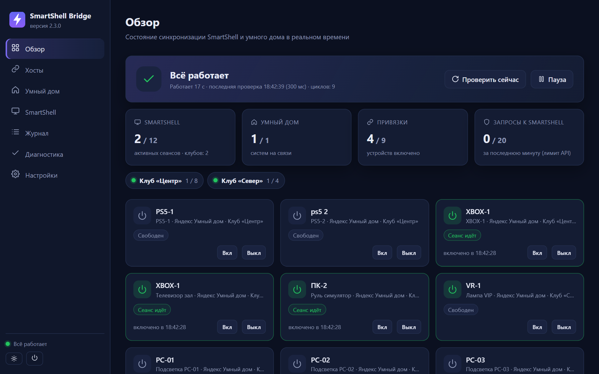
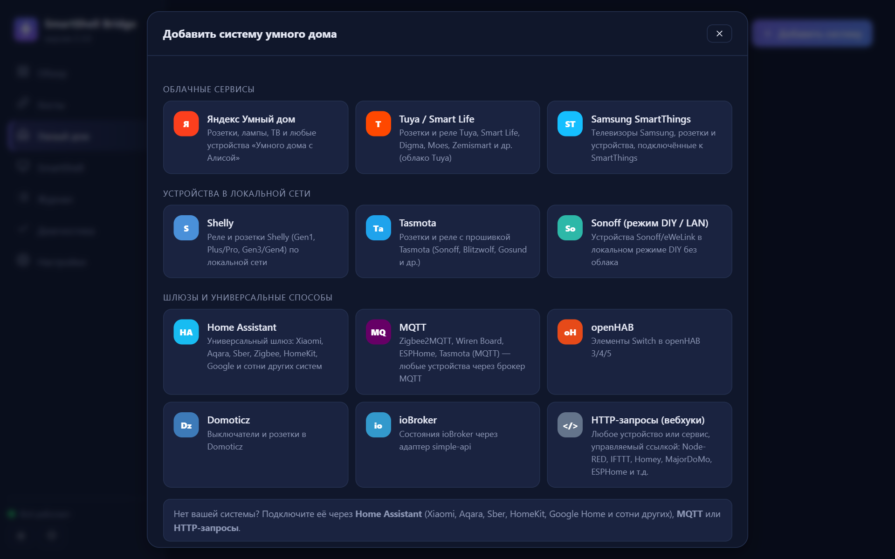
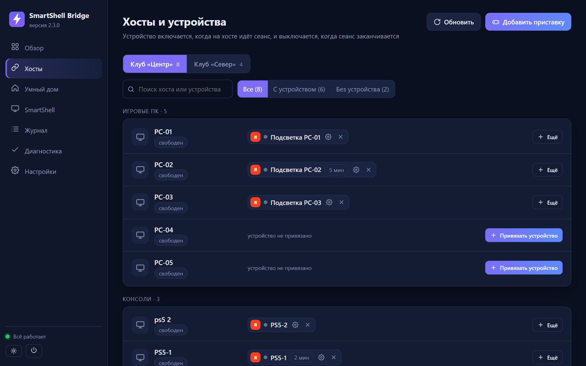
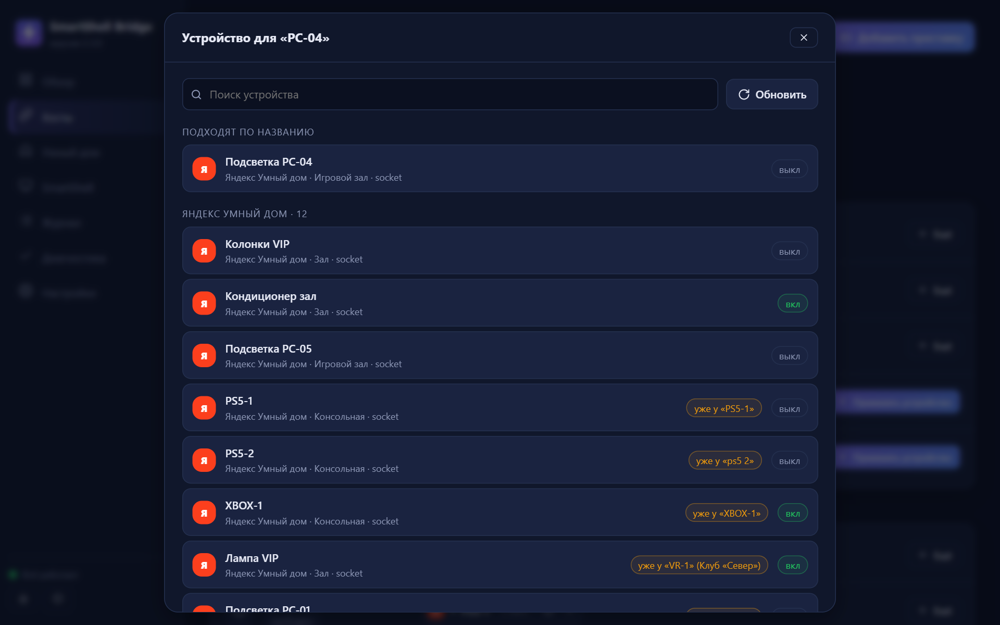
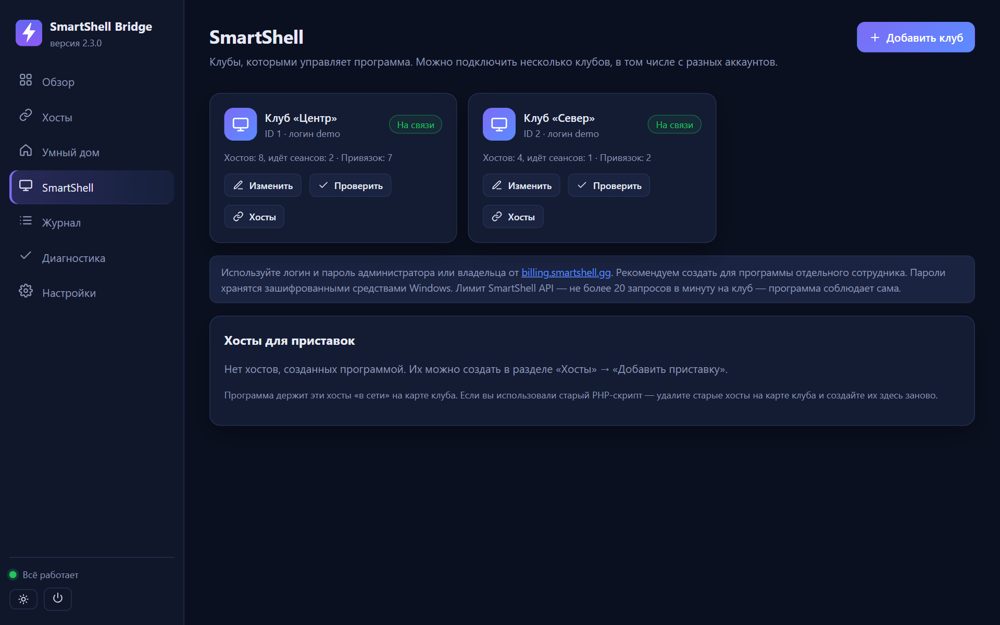
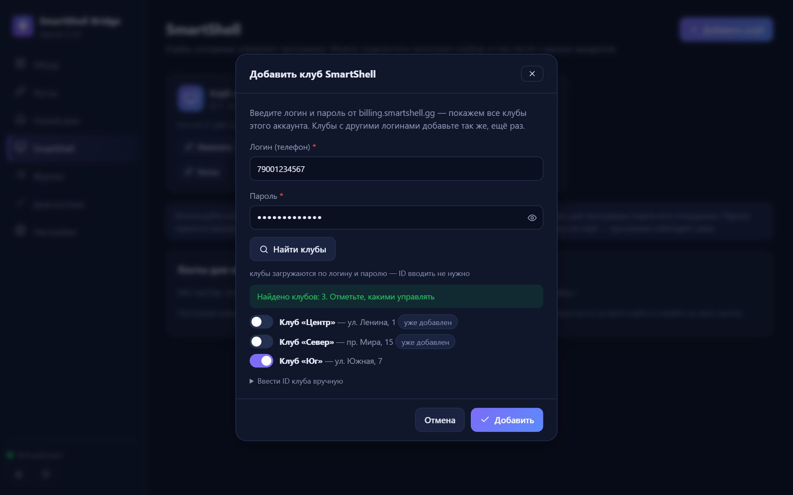

# SmartShell Bridge

Программа для компьютерных клубов на [SmartShell](https://smartshell.gg). Она включает розетки, приставки, телевизоры и любые устройства умного дома, когда на хосте начинается сеанс, и выключает их, когда сеанс заканчивается.

Скачали установщик, нажали «Далее» — готово. Не нужны OpenServer, PHP, планировщик задач или хостинг: программа запускается вместе с Windows и работает из трея.



> **Старая версия.** Первая версия проекта — PHP-скрипт `SmartShell_Alisa.php` для Яндекс Умного дома (запуск через OpenServer/cron). Он сохранён в папке [`old/`](old/) и больше не развивается. Как перейти на программу — в разделе [«Переход со старого PHP-скрипта»](#переход-со-старого-php-скрипта).

## Поддерживаемые системы



| Система | Как подключается |
|---|---|
| **Яндекс Умный дом (Алиса)** | облако, OAuth-токен |
| **Tuya / Smart Life** (Digma, Moes, Zemismart и большинство розеток с AliExpress) | облако Tuya, Access ID/Secret |
| **Samsung SmartThings** | облако, Personal Access Token |
| **Home Assistant** | REST API. Через него доступны Xiaomi/Aqara, Sber, HomeKit, Google Home, Zigbee и сотни других систем |
| **Shelly** (Gen1, Plus/Pro, Gen3/Gen4) | локальная сеть |
| **Tasmota** | локальная сеть |
| **Sonoff DIY / LAN** | локальная сеть |
| **MQTT** (Zigbee2MQTT, Wiren Board, ESPHome…) | брокер MQTT |
| **openHAB**, **Domoticz**, **ioBroker** | REST API |
| **HTTP-запросы (вебхуки)** | любые устройства и сервисы, которыми можно управлять по ссылке |

Можно подключить несколько систем одновременно.

## Быстрый старт

1. Скачайте `SmartShellBridge-Setup-<версия>.exe` в разделе [Releases](../../releases) и запустите его.
   - Права администратора не нужны: программа ставится для текущего пользователя. В окне установщика можно выбрать установку для всех.
   - На шаге «Дополнительные задачи» оставьте отмеченным «Запускать вместе с Windows».
   - Нужна версия без установки? Скачайте `SmartShellBridge.zip`, распакуйте и запустите `SmartShellBridge.exe`.
2. Откроется мастер настройки:
   1. **SmartShell**: введите логин и пароль от billing.smartshell.gg и нажмите «Найти клубы». Отметьте нужные клубы, ID искать не нужно.
   2. **Умный дом**: выберите систему и следуйте инструкции в окне. Кнопкой «Проверить» можно сразу убедиться, что подключение работает.
   3. **Привязки**: программа сама подберёт пары «хост ↔ устройство» с одинаковыми названиями (`PS5-1` ↔ `PS5-1`; кириллица и латиница считаются одинаковыми).
3. Готово. Программа сворачивается в трей рядом с часами. Цвет значка показывает состояние: 🟢 всё работает, 🟡 есть предупреждения, 🔴 нет связи, ⚪ пауза.

## Хосты и устройства

Раздел «Хосты» показывает все хосты вашего клуба из SmartShell, разбитые по группам. Если клубов несколько, сверху появляются вкладки клубов.
- **Привязать устройство.** Нажмите кнопку у хоста и выберите розетку из списка всех подключённых систем. Подходящие по названию стоят сверху, есть поиск. К одному хосту можно привязать несколько устройств, например приставку и телевизор.
- **Добавить приставку.** Подходит для PS5, Xbox, VR, симуляторов — всего, на чём нет шелла. Выберите розетку, и программа создаст хост с таким же названием на карте клуба, сразу привяжет его и будет держать «в сети».
- **Привязать все.** Если программа нашла хосты и устройства с одинаковыми названиями, она предложит связать их одной кнопкой.
- **Настройки привязки** (шестерёнка): задержка выключения, включение в сервисном режиме, инверсия, проверка «Вкл/Выкл».

Изменения сохраняются сразу.

| Хосты клуба | Выбор устройства |
|---|---|
|  |  |

## Несколько клубов

Программа может управлять несколькими клубами одновременно, в том числе с разных аккаунтов SmartShell.
- Клубы добавляются в разделе «SmartShell» → «Добавить клуб». По логину и паролю программа показывает все клубы аккаунта, нужные остаётся отметить. Клубы с другим логином добавьте так же, ещё раз.
- У каждого клуба своё подключение и свой лимит запросов. Если один клуб недоступен, устройства других клубов продолжают переключаться.
- На «Обзоре» видно состояние каждого клуба, в «Хостах» клубы переключаются вкладками.
- Настройки прошлых версий переносятся автоматически: ваш клуб, привязки и хосты приставок сохраняются.

| Клубы | Поиск клубов аккаунта |
|---|---|
|  |  |

## Возможности

- Обзор в реальном времени: где идёт сеанс, что включено, ручные «Вкл/Выкл»
- Задержка выключения — гость успеет сохранить игру
- Сервисный режим: устройство включается, когда хост в сервисе
- Инверсия: устройство включено, пока хост свободен
- Розетку выключили вручную во время сеанса — программа включит её снова
- Тестовый режим: только запись в журнал, без переключений
- Журнал, диагностика, уведомления в Telegram
- Пароль на вход: без него не изменить настройки и не закрыть программу (сброс — `--reset-password`)
- Доступ с телефона по сети клуба (по PIN-коду или паролю)
- Нет связи со SmartShell — устройства не переключаются, сеанс не прервётся
- Автозапуск с Windows, работа из трея, тёмная и светлая тема

## Где хранятся данные

`%APPDATA%\SmartShellBridge\` содержит `config.json`, резервную копию и папку `logs\`. При удалении программы установщик спросит, удалить ли и эти данные.

**Портативный режим:** положите рядом с exe пустой файл `portable.txt`, и данные будут храниться в папке `data\` рядом с программой.

Параметры командной строки: `--minimized` (свернуть в трей), `--quit` (закрыть запущенную программу), `--reset-password` (сбросить пароль на вход), `--no-browser`, `--no-tray`, `--debug`, `--selftest` (диагностика в консоли).

## Переход со старого PHP-скрипта

1. Остановите задание cron/OpenServer, которое вызывало `SmartShell_Alisa.php?d=check`.
2. Удалите с карты клуба хосты, которые создавал старый скрипт (их токены хранились в файлах рядом со скриптом).
3. В программе создайте их заново: «Хосты» → «Добавить приставку» (выберите розетку — хост с таким же названием создастся и привяжется сам).

## Сборка из исходников

Нужны Windows и Python 3.11+:

```powershell
powershell -ExecutionPolicy Bypass -File build.ps1
```

Скрипт установит зависимости, прогонит тесты и соберёт установщик `dist\SmartShellBridge-Setup-<версия>.exe` (нужен [Inno Setup 6](https://jrsoftware.org/isinfo.php): `winget install JRSoftware.InnoSetup`) и портативный архив `dist\SmartShellBridge.zip`. При публикации тега `v*` GitHub Actions соберёт оба файла и прикрепит их к релизу.

Демо-стенд для проверки интерфейса без настоящего клуба: `python tests/demo_server.py`, затем откройте http://127.0.0.1:18900.

Запуск без сборки: `cd src && python -m ssbridge`.

### Как добавить новую систему умного дома

Создайте класс в `src/ssbridge/connectors/`, унаследуйте его от `Connector`, опишите поля настроек в `fields` и реализуйте `list_devices()` и `set_state()`. Форма настроек в интерфейсе построится автоматически.

## Вопросы

Telegram: https://t.me/zaifat
